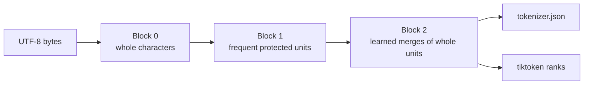
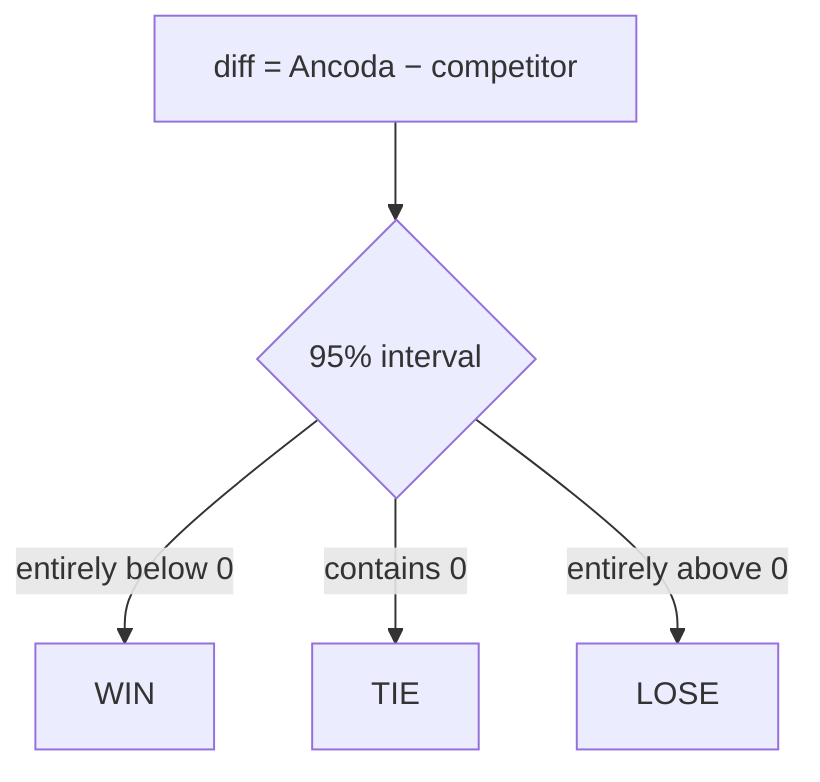

# Ancoda tokenizer

**Fewer tokens are not enough.**

Ancoda is a lossless byte-level BPE. Frequent Devanagari letter units sit in an ordinary merge table, so a covered unit is never cut. At 32k, 64k, 128k and 250k it has the lowest mean tokens per word on Devanagari text of the 20 tokenizers in the paper. It loses English from 32k to 128k.

That count did not predict the model. We trained 59M-parameter language models that differ only in the tokenizer, three seeds each, under a rule written down beforehand. A Nepali-only tokenizer needs 6% fewer Nepali tokens, and Ancoda’s model still has 4% lower bits per byte. Plain BPE trained on the same text needs more Nepali tokens and matches Ancoda. The small lead over Yak on text from Ancoda’s own sources disappears on FLORES+.

The write-up is *Fewer Tokens Are Not Enough* (Suryodaya Bikram Shahi, Ancoda Labs, Kathmandu). Numbers below are that paper’s. Full tables: [`docs/RESULTS_PER_SENTENCE.md`](docs/RESULTS_PER_SENTENCE.md) and [`docs/MODEL_EVAL_RESULTS.md`](docs/MODEL_EVAL_RESULTS.md).

<p align="center">
  
</p>

<p align="center">
  
</p>

<p align="center">
  
</p>

## Contents

- [Using the tokenizer](#using-the-tokenizer)
- [How a string is cut](#how-a-string-is-cut)
- [What the models showed](#what-the-models-showed)
- [Tokens per word](#tokens-per-word)
- [Integrity](#integrity)
- [Builds](#builds)
- [License](#license)
- [Comparison arms](#comparison-arms)
- [Replication](REPLICATION.md)

## Using the tokenizer

The five final exports are on the [tokenizers-v1 release](https://github.com/SirAlchemist1/ancoda-tokenizer/releases/tag/tokenizers-v1): one Hugging Face `tokenizer.json` and one tiktoken rank file for each of the five builds. They are also on Hugging Face at [SirAlchemist1/ancoda-tokenizer](https://huggingface.co/SirAlchemist1/ancoda-tokenizer). They are trained results, licensed under [CC BY-NC 4.0](LICENSE-DATA), the same licence as the other result files.

```bash
gh release download tokenizers-v1 --repo SirAlchemist1/ancoda-tokenizer --pattern 'ancoda-64k.*'
```

```python
from tokenizers import Tokenizer

tok = Tokenizer.from_file("ancoda-64k.tokenizer.json")
tok.encode_special_tokens = True
text = "नेपालको राजधानी काठमाडौं हो।"
print(len(tok.encode(text, add_special_tokens=False).ids))
```

The rank file is the same encoder. The pre-tokenizer pattern is `configs/pretokenizer_pattern.txt` in this repository:

```python
import base64
from pathlib import Path

import tiktoken

ranks = {}
for line in Path("ancoda-64k.tiktoken").read_text(encoding="utf-8").splitlines():
    encoded, rank = line.split(" ")
    ranks[base64.b64decode(encoded)] = int(rank)
pattern = Path("configs/pretokenizer_pattern.txt").read_text(encoding="utf-8")
enc = tiktoken.Encoding(
    name="ancoda-64k",
    pat_str=pattern,
    mergeable_ranks=ranks,
    special_tokens={},
)
text = "नेपालको राजधानी काठमाडौं हो।"
print(len(enc.encode_ordinary(text)))
```

`encode_special_tokens = True` and `add_special_tokens=False` are the load used for the fertility tables. On the rank file that call is `encode_ordinary`. The two snippets print the same count for this sentence. The other filenames are `ancoda-32k`, `ancoda-ne-64k`, `ancoda-128k` and `ancoda-250k`.

## How a string is cut

Text is not normalized. Every byte string encodes, and decoding returns it. The pre-tokenizer is the public o200k pattern with two edits: ZWJ and ZWNJ stay inside a word, and every digit is its own pre-token.

A **protected unit** is an extended grapheme cluster under Unicode 16.0, then split so every Devanagari letter starts a new unit. It is one letter plus its marks. It is smaller than a traditional akshara. `स्कूल` is `स्` · `कू` · `ल`. `क्ष` is `क्` · `ष`. Learned merges may join those units later.



Token IDs are merge priority. Blocks 0 and 1 rank below every learned merge, so a covered unit is assembled before a learned merge can touch it. Both exports use that same encoder ([`docs/SPEC.md`](docs/SPEC.md) §3.5). At 64k, Block 1’s 1,966 merges cover 99.97% of Devanagari unit occurrences in the inventory sample. The last 1,024 IDs are reserved. Of the other 64,512, the 64k build gives 48,000 to Devanagari.

## What the models showed

Arms, data, metric and the decision rule were registered before the full runs ([`docs/MODEL_EVAL_PREREG.md`](docs/MODEL_EVAL_PREREG.md)). Each arm is a Llama-style decoder, 8 layers, hidden size 512, about 59M parameters, trained for 1.0B tokens. Only the embedding table changes. Bits per byte do not depend on how the text is split. “Ancoda better” means all three seeds agree and the mean gap is larger than the standard deviation across seeds.

The same 7.19 GB stream is read by every arm. Ancoda reaches the equal-bytes checkpoint sooner because it uses fewer tokens on that stream than sidskarki. At that stop, Ancoda’s learning rate is still about three times its final value.

### Sealed text

Bits per byte, mean of 3 seeds. Lower is better. “vs” is (Ancoda − other) / other.

| Checkpoint | Text | Ancoda | Yak v1 | Yak v2 | sidskarki | plain BPE |
|---|---|---:|---:|---:|---:|---:|
| Equal tokens | Nepali | 0.4655 | 0.4674 −0.42% better | 0.4674 −0.40% better | 0.4850 −4.03% better | 0.4648 +0.16% no difference |
| Equal tokens | Deva-11 | 0.7463 | 0.7484 −0.29% better | 0.7513 −0.68% better | 0.7793 −4.24% better | 0.7404 +0.80% worse |
| Equal bytes | Nepali | 0.4761 | 0.4784 −0.48% better | 0.4775 −0.29% better | 0.4850 −1.85% better | 0.4773 −0.26% no difference |
| Equal bytes | Deva-11 | 0.7645 | 0.7681 −0.47% better | 0.7697 −0.67% better | 0.7793 −1.90% better | 0.7626 +0.25% no difference |

Deva-11 is the unweighted mean of Hindi, Marathi, Nepali, Sanskrit, Angika, Awadhi, Bhojpuri, Konkani, Chhattisgarhi, Maithili and Newari.

On FLORES+, scored by sentence, Ancoda and Yak v1 are level on Nepali, and Yak v1 is 0.5–0.6% lower on the Devanagari mean. The sealed lead does not survive a change of source.

Plain BPE was trained on Ancoda’s text and pre-tokenizer, without protected units, bans or a script budget. On FLORES+ Nepali it needs 2.7% more tokens (1.490 against 1.451) and the models match. The gain over Yak and sidskarki tracks the training text and the pre-tokenizer. The letter-unit design did not add bits per byte. We did not test tasks that need intact letters, such as spelling.

What did line up with sealed model quality is tokens per byte on the models’ own stream: plain BPE 0.1464, Ancoda 0.1510, Yak v1 0.1511, Yak v2 0.1534, sidskarki 0.2158.

### Joiners are a loss

Inserting a joiner after every virama makes Ancoda’s models worse. The same comparison at equal tokens, on 2,000 sealed Nepali documents:

| Text | Ancoda | Yak v1 | sidskarki | Verdict vs Yak / sidskarki |
|---|---:|---:|---:|---|
| Clean | 0.4782 | 0.4807 | 0.5007 | better / better |
| 10% misspelled | 0.5637 | 0.5684 | 0.5886 | better / better |
| ZWJ inserted | 1.0500 | 0.9495 | 0.9600 | worse / worse |
| ZWNJ inserted | 1.1280 | 0.9626 | 0.9859 | worse / worse |

A rebuild without the synthetic joiner copy (arm F) closes most of the ZWJ gap and does not fix ZWNJ. On FLORES+ that rebuild is worse on ZWNJ by about 0.11 bits per byte. Ordinary sealed text is unchanged.

The test uses 59M parameters and 1B tokens. The 0.4% gap against Yak v1 may shrink, grow, or vanish at a larger scale. Bits per byte are next-token prediction. No downstream task was run.

## Tokens per word

Fertility is tokens divided by whitespace-separated words. **Lower is better.** Each sentence or document is encoded on its own. Encoding a whole file at once makes SentencePiece models pay extra tokens at line breaks. An earlier board did that: sidskarki’s Nepali fertility rose from 1.370 to 1.445, and a loss looked like a tie. That board is kept in [`docs/GATE_A.md`](docs/GATE_A.md). It is not the comparison used here.

A result is a win or a loss only when a paired bootstrap 95% interval on the difference excludes zero (seed `20261104`, 10,000 resamples). Diff = Ancoda − competitor.



### 64k on FLORES+

Each sentence encoded separately. Lowest value in bold. The Devanagari mean is the unweighted mean of the first seven languages.

| | Nepali | Hindi | Maithili | Bhojpuri | Awadhi | Magahi | Sanskrit | Marathi | Chhattisgarhi | Deva. mean | English |
|---|---:|---:|---:|---:|---:|---:|---:|---:|---:|---:|---:|
| **Ancoda-64k** | 1.451 | **1.340** | 1.427 | **1.429** | **1.379** | **1.406** | **2.200** | **1.801** | **1.415** | **1.519** | 1.414 |
| Yak v1 | 1.457 | 1.381 | 1.452 | 1.478 | 1.470 | 1.445 | 2.347 | 2.451 | 1.526 | 1.576 | **1.388** |
| Yak v2 | 1.470 | 1.391 | **1.422** | 1.435 | 1.421 | 1.433 | 2.331 | 2.447 | 1.490 | 1.558 | 1.420 |
| sidskarki | **1.370** | 1.615 | 1.753 | 1.690 | 1.629 | 1.659 | 2.516 | 2.468 | 1.655 | 1.748 | 2.346 |

Against Yak v1, Ancoda-64k wins all nine Devanagari languages and loses English. Against Yak v2 it wins eight and loses Maithili by 0.004. Against sidskarki it loses Nepali and wins the rest. Sarvam-1 is 0.033 lower than Ancoda-64k on Marathi.

### Nepali, four sets

| Test set | Ancoda | Yak v1 | Yak v2 | sidskarki | Ancoda-NE |
|---|---:|---:|---:|---:|---:|
| FLORES+ | 1.451 | 1.457 | 1.470 | 1.370 | 1.405 |
| Aya | 1.441 | 1.446 | 1.455 | 1.407 | 1.396 |
| Held-out web | 1.293 | 1.300 | 1.313 | 1.236 | 1.248 |
| Sealed (28,094 docs) | 1.308 | 1.316 | 1.329 | 1.232 | 1.263 |

Every interval against Yak excludes zero. The margins over Yak v1 are under 0.7%. sidskarki is 2.4% to 5.8% lower. On the sealed set that Nepali-only vocabulary costs 22% more tokens on Hindi (1.611 against 1.315) and 65% more on English (2.426 against 1.471).

### Devanagari mean by size

Unweighted mean of seven FLORES+ languages (Awadhi, Bhojpuri, Hindi, Magahi, Maithili, Nepali, Sanskrit). Ancoda is lowest in every size class. The percentage is how many more tokens the other tokenizer needs. Every difference has a 95% interval below zero.

| Class | Ancoda | Next and the wide gaps |
|---|---:|---|
| 32k | 1.65 | Yak v1 1.74, +5.1% |
| 64k | 1.52 | Yak v2 +2.6%, Yak v1 +3.8%, sidskarki +15%, HimalayaAI 64k +22%, Sarvam-1 +30%, Arkios +34% |
| 128k | 1.43 | Yak v2 +1.6%, Yak v1 +2.7%, HimalayaAI 128k +22%, HimalayaAI 100k +24%, Sarvam-M +81%, Llama-3 +117%, Qwen3 +274% |
| 250k | 1.38 | IndicBERT v2 +8.8%, BLOOM +27%, Gemma 3 +36%, Sarvam-30B +36%, GPT-4o +53% |

At 128k Ancoda loses Nepali to Yak v1 by 0.0045 on FLORES+ and wins it by 0.0015 on the sealed set. At 250k it ties IndicBERT v2 on Hindi and English and loses Marathi. GPT-4o’s o200k needs 53% more tokens than Ancoda-250k on this mean. HimalayaAI is close on Nepali at 64k (1.49 against 1.45) and better on English. Its Hub repositories state no licence. The comparison is local, and those files are not redistributed.

The sealed list, with 65 joiner-source documents removed, is [`docs/sealed_test_set_no_joiners.json`](docs/sealed_test_set_no_joiners.json) (n = 35,623). It was fixed before the final builds and was not used to choose a configuration.

## Integrity

On 10 million training lines (1 million for 32k) and every evaluation text, all five builds had zero boundaries inside a covered unit, zero multi-character vocabulary entries that begin with a mark or a joiner, and zero round-trip failures. Rare units outside Block 1 can still be split. At 64k that is 0.03% of occurrences, and most of those uncovered units are broken.

FLORES+ Nepali, each sentence encoded separately. Mark-initial is the share of tokens that begin with a combining mark. Joiner cost is tokens after inserting a joiner after every virama, divided by tokens before. 1.00 would mean no extra tokens.

| Tokenizer | Mark-initial | ZWJ | ZWNJ |
|---|---:|---:|---:|
| Ancoda-64k | 0.007% | 1.35 | 1.35 |
| Yak v2 64k | 0.156% | 1.50 | 1.69 |
| sidskarki-64k | 1.57% | 2.56 | 2.56 |
| HimalayaAI 64k | 2.51% | 2.44 | 2.44 |
| Yak v1 64k | 9.2% | 1.66 | 1.97 |
| Arkios | 15.1% | 2.21 | 2.21 |
| GPT-4o | 25.7% | 1.53 | 1.56 |
| Llama-3 | 54.9% | 1.14 | 1.27 |

Llama-3 and GPT-4o have low joiner ratios because they already split Nepali into many more tokens. More than half of Llama-3’s Nepali tokens begin with a detached mark. sidskarki reproduces 99.5% of FLORES+ Nepali sentences and 80.3% of sealed Nepali documents byte for byte. The byte-level tokenizers reproduce all of them.

## Builds

| Name | Vocab | Block 1 merges | Coverage | Devanagari budget | Role |
|---|---:|---:|---:|---:|---|
| ancoda-32k | 32,768 | 983 | 99.910% | 23,522 | Small footprint |
| ancoda-64k | 65,536 | 1,966 | 99.967% | 48,000 | Flagship |
| ancoda-ne-64k | 65,536 | 1,966 | 99.967% | Nepali only | Single-language control |
| ancoda-128k | 131,072 | 3,932 | 99.978% | 94,742 | Larger general build |
| ancoda-250k | 250,000 | 7,500 | 99.981% | 160,000 | Largest build |

Training text is about 5 GB (10 GB for 250k): 60% Nepali, of which 1 point is a joiner copy, 16% English, 8% Hindi, 9.6% other Devanagari, 4% code, 2.4% mathematics. The 250k mix down-weights code and mathematics because no script budget met the rule written in advance. Wikipedia and every evaluation set are excluded. The five exports are on the [tokenizers-v1 release](https://github.com/SirAlchemist1/ancoda-tokenizer/releases/tag/tokenizers-v1).

Spec: [`docs/SPEC.md`](docs/SPEC.md). Decisions: [`docs/DECISIONS.md`](docs/DECISIONS.md). Evidence hashes: [`docs/EVIDENCE_FINAL_BUILD.md`](docs/EVIDENCE_FINAL_BUILD.md). How to re-check the guarantee and the bits-per-byte definition: [`REPLICATION.md`](REPLICATION.md).

## License

Copyright (c) 2026 Ancoda Labs Pvt. Ltd. Both licences below are noncommercial. **Commercial use of any part of this project needs a separate licence from Ancoda Labs.**

| What | Licence |
|---|---|
| Code: `crates/`, `python/`, `scripts/`, `tests/`, `configs/`, `Makefile`, `Cargo.toml`, `Cargo.lock`, `pyproject.toml`, `uv.lock`, `rust-toolchain.toml` | [`LICENSE`](LICENSE), PolyForm Noncommercial 1.0.0 |
| Ancoda tokenizer files (`tokenizer.json` and tiktoken ranks for every Ancoda build, distributed separately from this repo) | [`LICENSE-DATA`](LICENSE-DATA), CC BY-NC 4.0 |
| All of `docs/` (including pre-registration, evidence, and sealed document-ID lists) | [`LICENSE-DATA`](LICENSE-DATA), CC BY-NC 4.0 |
| Result and snapshot files: `artifacts/` (local, not committed), `docs/model_eval_logs/` | [`LICENSE-DATA`](LICENSE-DATA), CC BY-NC 4.0 |

The Unicode-to-Preeti table in `python/ancoda_tok/clean/preeti_convert.py` is from [globalpolicy/UnicodeToPreeti](https://github.com/globalpolicy/UnicodeToPreeti) and stays under its MIT licence. Third-party tokenizers, datasets, and their licences are listed in [`docs/LICENSES.md`](docs/LICENSES.md). None of their files are covered by either Ancoda licence.

## Comparison arms

Yak, sidskarki-64k, HimalayaAI, Arkios and the other tokenizers in the tables are evaluation-only, inside their own licences. Their vocabularies, merges and regexes stay out of the Ancoda build. Models trained with Yak or sidskarki are not released.

HimalayaAI’s Hub repositories state no licence. Those measurements are local, and the files are not copied or redistributed. FLORES+ text is never re-hosted in this repository.
