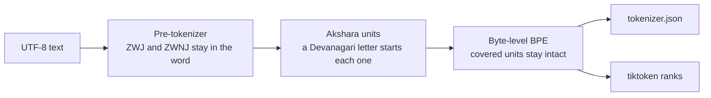
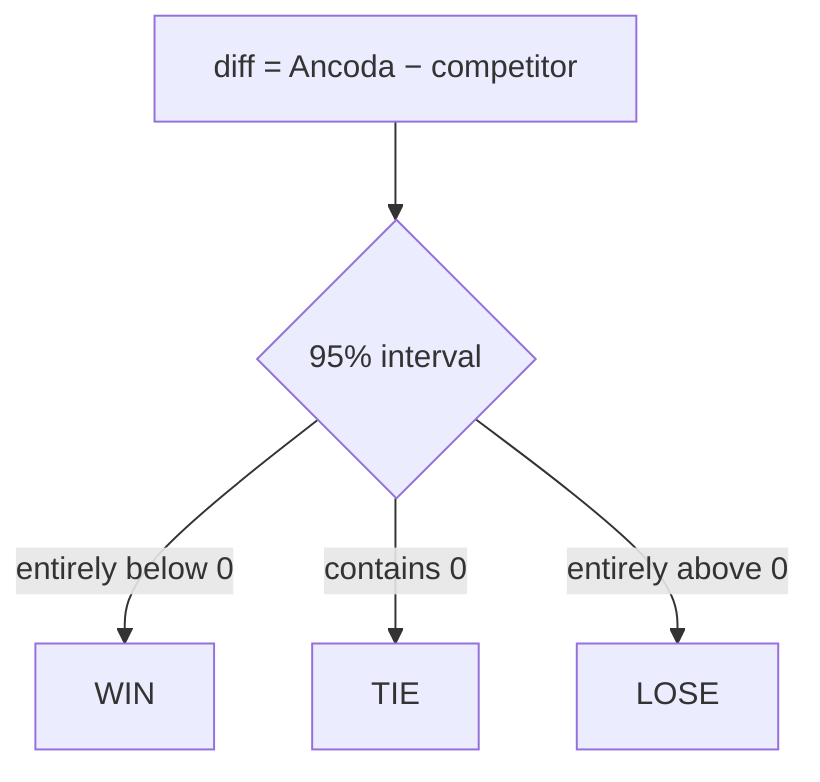

# Ancoda tokenizer

**Whole aksharas. Fewer Nepali tokens. Nothing dropped.**

ancoda-64k is a lossless, Nepali-first byte-level BPE. On the frozen FLORES+ scoreboard it beats both Yak 64k builds on Nepali, Hindi, and the Devanagari mean. English is a win against Yak v2.0 and a loss against Yak v1.

  

  

Those Nepali gaps are **WIN** −0.0059 against Yak v1 and **WIN** −0.0193 against Yak v2.0. The bars are zoomed so the gap is visible. The full scoreboard, including the losses, is below.

Companion builds: **ancoda-32k**, **ancoda-ne-64k**, **ancoda-128k**, **ancoda-250k**. Each build exports a Hugging Face `tokenizer.json` and a tiktoken rank file. Both exports reproduce the canonical encoder in [docs/SPEC.md §3.5](docs/SPEC.md). Tokenizer files ship separately from this repository.

Frozen M8 results: [`docs/GATE_A.md`](docs/GATE_A.md). Spec: [`docs/SPEC.md`](docs/SPEC.md). Decisions: [`docs/DECISIONS.md`](docs/DECISIONS.md). Evidence hashes: [`docs/EVIDENCE_M8.md`](docs/EVIDENCE_M8.md). Sentence-level comparisons: [`docs/RESULTS_PER_SENTENCE.md`](docs/RESULTS_PER_SENTENCE.md).

## From text to tokens

`स्कूल` is `स्` · `कू` · `ल`. A conjunct such as `क्ष` is `क्` · `ष`. Marks stay on their letter. BPE may join those units into a longer token. It may not cut a covered unit in half.

## Contents

- [From text to tokens](#from-text-to-tokens)
- [How to read a verdict](#how-to-read-a-verdict)
- [FLORES+ headline](#flores-headline)
- [Absolute fertilities](#absolute-fertilities)
- [sidskarki reporting path](#sidskarki-reporting-path)
- [HimalayaAI BPE-128k](#himalayaai-bpe-128k)
- [What the scoreboard shows](#what-the-scoreboard-shows)
- [Sealed holdout](#sealed-holdout)
- [Builds](#builds)
- [License](#license)
- [Comparison arms](#comparison-arms)

## How to read a verdict

Fertility is tokens per whitespace-separated word. **Lower is better.**

Diff = Ancoda − competitor. A negative diff means Ancoda uses fewer tokens.

| Verdict | Rule |
|---|---|
| **WIN** | 95% confidence interval lies entirely below 0 |
| **TIE** | The interval contains 0 |
| **LOSE** | The interval lies entirely above 0 |

Intervals are paired bootstraps with seed `20261104` and 10,000 resamples. The headline tables below are the frozen Gate A scoreboard: FLORES+ devtest, **whole file joined by newlines, first byte**, unless a row is marked per-line.

[`docs/RESULTS_PER_SENTENCE.md`](docs/RESULTS_PER_SENTENCE.md) encodes each FLORES+ sentence on its own. That file supersedes the whole-file tables for later comparisons. The Gate A pass/fail bars stay as written. Sealed-holdout numbers are report-only. They never change training or configuration.

## FLORES+ headline

Whole-file first-byte unless a dagger says otherwise. Full intervals, robustness checks, and the PLAN 3.10 gates are in [`docs/GATE_A.md`](docs/GATE_A.md).

### ancoda-64k

| Competitor | Nepali | English | Hindi | Devanagari mean |
|---|---|---|---|---|
| yak-64k-v1 | **WIN** −0.0059 | LOSE +0.0263 | **WIN** −0.0406 | **WIN** −0.0571 |
| yak-64k-v2.0 | **WIN** −0.0193 | **WIN** −0.0059 | **WIN** −0.0509 | **WIN** −0.0389 |
| sidskarki-64k † | TIE +0.0061 | **WIN** −0.9942 | **WIN** −0.3264 | **WIN** −0.2862 |
| arkios | **WIN** −0.2369 | LOSE +0.1174 | **WIN** −0.6324 ‡ | **WIN** −0.5238 ‡ |
| sarvam-1 | **WIN** −1.1384 ‡ | **WIN** −0.0206 ‡ | **WIN** −0.0616 ‡ | **WIN** −0.4509 ‡ |

† Frozen scoreboard used sidskarki **whole-file** FLORES fertility (1.4448). The chosen reporting path is **per-line** SentencePiece (1.3699). On that path ancoda-64k and ancoda-ne-64k **LOSE** Nepali. See [sidskarki reporting path](#sidskarki-reporting-path).

‡ That baseline was encoded per line.

### ancoda-ne-64k

Nepali-heavy 64k. It spends vocabulary on Nepali and gives up English and Hindi.

| Competitor | Nepali | English | Hindi | Devanagari mean |
|---|---|---|---|---|
| yak-64k-v1 | **WIN** −0.0515 | LOSE +0.8629 | LOSE +0.2117 | LOSE +0.1637 |
| sidskarki-64k † | **WIN** −0.0395 | **WIN** −0.1576 | **WIN** −0.0741 | **WIN** −0.0654 |

### ancoda-128k

| Competitor | Nepali | English | Hindi | Devanagari mean |
|---|---|---|---|---|
| yak-128k-v1 | LOSE +0.0045 | LOSE +0.0105 | **WIN** −0.0193 | **WIN** −0.0392 |
| yak-128k-v2.0 | **WIN** −0.0079 | **WIN** −0.0108 | **WIN** −0.0287 | **WIN** −0.0232 |
| himalaya-128k § | **WIN** −0.0873 | TIE +0.0034 | **WIN** −0.2406 | **WIN** −0.3755 |
| llama3 / sarvam-m / qwen2.5 / qwen3 | **WIN** (large) | LOSE on English | **WIN** | **WIN** |

§ HimalayaAI BPE-128k has 128,000 pieces. Same whole-file first-byte bootstrap (seed `20261104`, 10,000 resamples). This row is off the frozen Gate A scoreboard: the Hub card states no license. Detail is in [HimalayaAI BPE-128k](#himalayaai-bpe-128k).

Exact diffs against Llama-3, Sarvam-M, Qwen2.5, and Qwen3 are in [`docs/GATE_A.md`](docs/GATE_A.md).

### ancoda-250k

| Competitor | Nepali | English | Hindi | Devanagari mean |
|---|---|---|---|---|
| indicbert-v2 | **WIN** −0.2500 ‡ | **WIN** −0.0079 ‡ | TIE +0.0034 ‡ | **WIN** −0.1216 ‡ |
| bloom / gemma3 / sarvam-30b | **WIN** | **WIN** | **WIN** | **WIN** |

‡ IndicBERT v2 was encoded per line. Exact diffs against Bloom, Gemma 3, and Sarvam-30B are in [`docs/GATE_A.md`](docs/GATE_A.md).

### ancoda-32k

| Competitor | Nepali | English | Hindi | Devanagari mean |
|---|---|---|---|---|
| yak-32k-v1 | **WIN** −0.0144 | LOSE +0.0338 | **WIN** −0.0713 | **WIN** −0.0857 |

## Absolute fertilities

FLORES+ columns on the same whole-file measurement as the headline, except sidskarki, which is the whole-file figure called out above.

| Model | Nepali | English | Hindi | Devanagari mean |
|---:|---:|---:|---:|---:|
| ancoda-64k | 1.4509 | 1.4144 | 1.3401 | 1.5188 |
| ancoda-ne-64k | 1.4053 | 2.2510 | 1.5924 | 1.7396 |
| ancoda-128k | 1.3745 | 1.3019 | 1.2773 | 1.4317 |
| ancoda-250k | 1.3284 | 1.2287 | 1.2404 | 1.3767 |
| ancoda-32k | 1.5715 | 1.5721 | 1.4373 | 1.6547 |
| yak-64k-v1 | 1.4568 | 1.3881 | 1.3808 | 1.5759 |
| yak-64k-v2.0 | 1.4702 | 1.4203 | 1.3910 | 1.5577 |
| sidskarki-64k (whole-file) | 1.4448 | 2.4086 | 1.6665 | 1.8050 |

## sidskarki reporting path

Hub ships only `nepali_bpe_64k.model`. The frozen scoreboard encoded the whole FLORES file in one SentencePiece call and recorded Nepali fertility **1.4448**. The chosen path encodes each line on its own and records **1.3699**.

Under the chosen path, ancoda-64k and ancoda-ne-64k **LOSE** on FLORES Nepali against sidskarki. Hindi, English, and the Devanagari mean in the frozen table are a different comparison from that chosen Nepali number. The audit, both fertilities, and the recomputed verdicts are in [`docs/GATE_A.md`](docs/GATE_A.md).

## HimalayaAI BPE-128k

Local comparison only. The Hub card states no license, so this model is off the frozen Gate A scoreboard and is not redistributed.

FLORES+ devtest, whole file joined by newlines, tokens / `str.split()` words. Diff = Ancoda − HimalayaAI. **WIN** means the 95% interval is entirely below 0 (seed `20261104`, 10,000 line resamples, whole-file first byte). ancoda-128k has 131,072 ids. HimalayaAI BPE-128k has 128,000 pieces.

| Ours | Nepali | English | Hindi | Devanagari mean |
|---|---|---|---|---|
| ancoda-128k | **WIN** −0.0873 | TIE +0.0034 | **WIN** −0.2406 | **WIN** −0.3755 |
| ancoda-64k | TIE −0.0109 | LOSE +0.1159 | **WIN** −0.1777 | **WIN** −0.2885 |
| ancoda-250k | **WIN** −0.1334 | **WIN** −0.0698 | **WIN** −0.2775 | **WIN** −0.4306 |

On the nearest size, ancoda-128k uses **6.0%** fewer Nepali tokens (1.3745 vs 1.4618), **15.9%** fewer Hindi tokens (1.2773 vs 1.5179), and **20.8%** fewer tokens on the seven-language Devanagari mean (1.4317 vs 1.8072). English is a tie (1.3019 vs 1.2985).

| | ancoda-128k | HimalayaAI BPE-128k |
|---|---:|---:|
| Nepali fertility | 1.3745 | 1.4618 |
| English fertility | 1.3019 | 1.2985 |
| Hindi fertility | 1.2773 | 1.5179 |
| Devanagari mean | 1.4317 | 1.8072 |
| Nepali lines, exact round-trip | 1,012 / 1,012 | 1,004 / 1,012 |
| Nepali lines that keep every character | 1,012 / 1,012 | 1,010 / 1,012 |
| Orphan-mark share, Nepali | 0.0039% | 1.89% |
| ZWJ token ratio | 1.2698 | 2.4457 |
| ZWNJ token ratio | 1.2737 | 2.4457 |

HimalayaAI’s vocabulary has no piece containing ऊ, ऋ, ऐ, ः, ़, ऽ, ॥, or ॐ. Two of 1,012 Nepali lines lose characters, so its fertility is slightly flattered. The gaps above are much larger than that loss.

The ZWJ and ZWNJ ratios are the Gate A probe: a joiner is inserted after every virama before a Devanagari letter, and the ratio is tokens(rewritten) / tokens(original) on the Nepali devtest. A ratio near 1 means the joiner barely lengthens the encoding.

ancoda-32k loses Nepali (+0.1097) and English (+0.2736) to this 128k model and wins Hindi (−0.0806) and the Devanagari mean (−0.1525). ancoda-ne-64k wins Nepali (−0.0565) and the Devanagari mean (−0.0677) and loses English (+0.9526) and Hindi (+0.0746).

## What the scoreboard shows

- **ancoda-64k vs Yak 64k v1 and v2.0.** Win on Nepali, Hindi, and the Devanagari mean. Win on English against v2.0. Lose English against v1.
- **ancoda-64k vs sidskarki, Arkios, and Sarvam-1.** Win on Hindi and the Devanagari mean, and on English against sidskarki and Sarvam-1. Nepali vs sidskarki follows the [chosen per-line path](#sidskarki-reporting-path): a loss.
- **ancoda-128k vs Yak 128k v2.0.** Win on Nepali, English, Hindi, and the Devanagari mean. Against v1: win on Hindi and the Devanagari mean; lose Nepali and English by small margins.
- **ancoda-128k vs HimalayaAI BPE-128k.** Win on Nepali (−6.0% tokens), Hindi (−15.9%), and the Devanagari mean (−20.8%). English is a tie. Exact Nepali round-trip is 1,012/1,012 for Ancoda and 1,004/1,012 for HimalayaAI.
- **ancoda-128k and ancoda-250k vs large multilingual baselines** (Llama-3, Qwen, Sarvam-M, Bloom, Gemma 3, and the others in Gate A). Win on Nepali, Hindi, and the Devanagari mean. English is mixed.
- **ancoda-32k vs Yak 32k v1.** Win on Nepali, Hindi, and the Devanagari mean. Lose English.
- **Integrity, every Ancoda build.** 0 covered-akshara violations, 0 mark-initial tokens, exact Hugging Face ↔ tiktoken round-trip, and an orphan-mark share well below Yak v1. Counts are in [`docs/GATE_A.md`](docs/GATE_A.md).

## Sealed holdout

Report-only. The reduced list drops joiner-source documents: [`docs/sealed_test_set_no_joiners.json`](docs/sealed_test_set_no_joiners.json) (n = 35,623). Intervals are document-level.

### Nepali

| Pair | Verdict |
|---|---|
| ancoda-64k vs yak-64k-v1 / v2.0 | **WIN** −0.0084 / −0.0208 |
| ancoda-64k vs sidskarki (per-document SentencePiece) | LOSE +0.0754 |
| ancoda-ne-64k vs yak-64k-v1 / v2.0 | **WIN** −0.0531 / −0.0654 |
| ancoda-ne-64k vs sidskarki | LOSE +0.0308 |
| ancoda-128k vs yak-128k-v1 | **WIN** −0.0015 |

### Unweighted mean of 11 Devanagari groups

Hindi, Marathi, Nepali, Sanskrit, `anp`, `awa`, `bho`, `gom`, `hne`, `mai`, `new`.

| Pair | Verdict |
|---|---|
| ancoda-64k vs yak-v1 / v2.0 / sidskarki / arkios / sarvam-1 | **WIN** (sidskarki −0.2991) |
| ancoda-128k vs yak-128k-v1 / v2.0 / llama3 / sarvam-m / qwen | **WIN** |
| ancoda-250k vs indicbert / bloom / gemma3 / sarvam-30b | **WIN** |
| ancoda-32k vs yak-32k-v1 | **WIN** −0.1792 |
| ancoda-ne-64k vs yak-v1 / v2.0 | LOSE |
| ancoda-ne-64k vs sidskarki | TIE |

## Builds

| Name | Role |
|---|---|
| ancoda-64k | Flagship. Multilingual Devanagari plus English. |
| ancoda-ne-64k | Nepali-heavy 64k. Trades English and Hindi fertility for a lower Nepali count. |
| ancoda-128k | Larger general build. 131,072 ids. |
| ancoda-250k | Largest build. Frontier pick among the 250k points. |
| ancoda-32k | Small footprint. |

## License

Copyright (c) 2026 Ancoda Labs Pvt. Ltd. Both licences below are noncommercial. **Commercial use of any part of this project needs a separate licence from Ancoda Labs.**

| What | Licence |
|---|---|
| Code: `crates/`, `python/`, `scripts/`, `tests/`, `configs/`, `Makefile`, `Cargo.toml`, `Cargo.lock`, `pyproject.toml`, `uv.lock`, `rust-toolchain.toml` | [`LICENSE`](LICENSE), PolyForm Noncommercial 1.0.0 |
| Ancoda tokenizer files (`tokenizer.json` and tiktoken ranks for every Ancoda build, distributed separately from this repo) | [`LICENSE-DATA`](LICENSE-DATA), CC BY-NC 4.0 |
| All of `docs/` (including pre-registration, evidence, and sealed document-ID lists) | [`LICENSE-DATA`](LICENSE-DATA), CC BY-NC 4.0 |
| Result and snapshot files: `artifacts/` (local, not committed), `docs/m9_server_copy/` | [`LICENSE-DATA`](LICENSE-DATA), CC BY-NC 4.0 |

The Unicode-to-Preeti table in `python/ancoda_tok/clean/preeti_convert.py` is from [globalpolicy/UnicodeToPreeti](https://github.com/globalpolicy/UnicodeToPreeti) and stays under its MIT licence. Third-party tokenizers, datasets, and their licences are listed in [`docs/LICENSES.md`](docs/LICENSES.md). None of their files are covered by either Ancoda licence.

## Comparison arms

Yak, sidskarki-64k, HimalayaAI, and Arkios are evaluation-only, inside their own licences. Their vocabularies, merges, and regexes stay out of the Ancoda build.

HimalayaAI’s Hub card states no license. The comparison above is local, and that model is not redistributed. FLORES+ text is never re-hosted in this repository.
