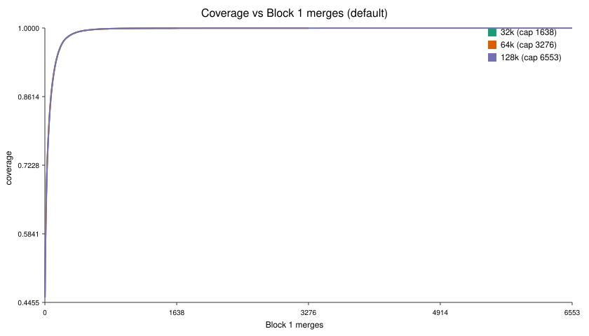
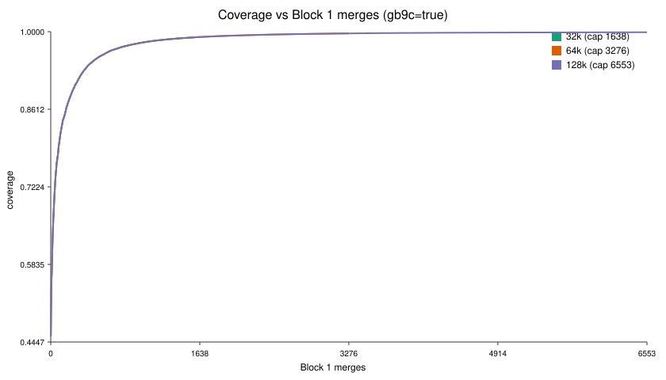

## baselines notes (Ancoda)

- Harness validity gate: **5/5** (Arkios-paper ±0.03 check).
- Reproduction vs Yak published table: see `artifacts/eval/baselines_reproduction.tsv` (all rows PASS within ±0.003).
- Yak v1 64k-phrase Nepali fertility (harness): see `configs/eval.yaml` → `baselines.yak_64k_phrase_nepali`.
- Sanskrit: harness `san_Deva` values recorded in `configs/eval.yaml`; IndicBERT v2 matches the reported 2.067; Yak blog 2.126 differs from this harness’s Yak measurement.
- **Languages of Nepal:** Yak’s 14 held-out sets are private and **not comparable**. This harness can rerun FLORES+ for `npi_Deva`, `mai_Deva`, `bho_Deva`, `awa_Deva`, `mag_Deva` (and `hin_Deva` / `san_Deva` / `eng_Latn`, plus non-Deva `bod_Tibt` / `sat_Olck`).
- Panel failure: `airavata` gated 403 (not required for baselines acceptance rows).

---

---

## cleaning — Training snapshots (Ancoda)

Four 5 GB snapshots (RAM < 32 GB → 5 GB each). Seed `20261104`.
Legacy-font filter disabled (dictionary Preeti detector precision 0.89 < 0.99).
Decontam: exact on all eval sets; 6–12 + 13-gram on FLORES+/Belebele/aya only;
MinHash near-dup (same settings as step 4) vs `fw2_npi_test` / `fw2_hin_test` / `c4_val`.
Independent audit: exact / segment / 13-gram / minhash_eval all **0** on every snapshot.
Free disk after build: **127.5 GB** (≥ 50 GB required).

| Snapshot | path | text_bytes | docs (sum) | joiner |
|---|---|---:|---:|---|
| `n45` | `data/snapshots/n45_868dd1887992c328` | 5000068588 | 2099708 | none |
| `n50` | `data/snapshots/n50_32fd1b6a9c068400` | 5000398763 | 2167288 | 1% (21348 docs / 50004482 B) |
| `n60` | `data/snapshots/n60_cf8066dbbdd0da93` | 5000710160 | 2313669 | none |
| `n50_nojoiner` | `data/snapshots/n50_nojoiner_3e785f409c11d076` | 5000095538 | 2168971 | none (ladder control) |

### Bytes per language (bucket) per snapshot

| Bucket | n45 | n50 | n60 | n50_nojoiner |
|---|---:|---:|---:|---:|
| Nepali | 2250002496 | 2500028405 | 3000001740 | 2500006506 |
| English | 1100008519 | 1000002558 | 800000683 | 1000011890 |
| Hindi | 550001672 | 500005528 | 400003339 | 500023240 |
| Marathi | 165011290 | 150142261 | 120010497 | 150011301 |
| Sanskrit | 165005077 | 150000246 | 120536929 | 150005876 |
| Smaller Devanagari | 220002508 | 200016985 | 160043316 | 200002873 |
| Languages of Nepal | 110000787 | 100062412 | 80009019 | 100002013 |
| Code | 275003861 | 250126946 | 200093646 | 250003405 |
| Math | 165032378 | 150013422 | 120010991 | 150028434 |
| **total** | 5000068588 | 5000398763 | 5000710160 | 5000095538 |

### Decontam audit

| Snapshot | exact | segment (6–12) | 13-gram | minhash_eval |
|---|---:|---:|---:|---:|
| `n45` | 0 | 0 | 0 | 0 |
| `n50` | 0 | 0 | 0 | 0 |
| `n60` | 0 | 0 | 0 | 0 |
| `n50_nojoiner` | 0 | 0 | 0 | 0 |

### Training bytes removed by decontamination (per source)

Text rules from `decontam_report.json`; MinHash near-dup from `minhash_eval_near_dup.json`.
MinHash total dropped: **20132** docs / **122711282** bytes.

| source | text drop bytes | MinHash drop bytes | total drop | input bytes | share |
|---|---:|---:|---:|---:|---:|
| code | 3460145 | 8607 | 3468752 | 998261389 | 0.3475% |
| deva_pool_fw2 | 18415865 | 13650 | 18429515 | 964462702 | 1.9109% |
| deva_pool_hplt | 4390001 | 0 | 4390001 | 504986458 | 0.8693% |
| deva_pool_sangraha | 876493 | 0 | 876493 | 174145735 | 0.5033% |
| fw2_hin | 134286991 | 592394 | 134879385 | 1485712545 | 9.0784% |
| fw2_mar | 310812 | 0 | 310812 | 498947556 | 0.0623% |
| fw2_npi | 74311674 | 5074838 | 79386512 | 15279926039 | 0.5195% |
| fw2_san | 2517196 | 0 | 2517196 | 348213007 | 0.7229% |
| fwedu_en | 183832533 | 4282 | 183836815 | 2998563161 | 6.1308% |
| hplt_npi | 77885326 | 16879648 | 94764974 | 6412988278 | 1.4777% |
| indiccorp_npi | 6486518 | 951199 | 7437717 | 12621064938 | 0.0589% |
| iriis | 31255248 | 25147770 | 56403018 | 13019540491 | 0.4332% |
| nepal_pool | 42486 | 0 | 42486 | 134371824 | 0.0316% |
| owm | 71948535 | 2936 | 71951471 | 999608469 | 7.1980% |
| sangraha_hin | 39579001 | 111077 | 39690078 | 456571246 | 8.6931% |
| sangraha_mar | 125407 | 0 | 125407 | 499655938 | 0.0251% |
| sangraha_nep | 78879901 | 73924881 | 152804782 | 22233931930 | 0.6873% |
| sangraha_san | 820025 | 0 | 820025 | 479330094 | 0.1711% |
| **total** |  |  | 852135439 | 80110281800 | 1.0637% |

Source: `artifacts/clean/snapshots.json`.

---

## akshara-inventory — Akshara inventory and Block 1 covered set

Snapshot: `data/snapshots/n50_32fd1b6a9c068400`. Seed `20261104`.
Counted every `aksharas()` unit with at least one U+0900–U+097F code point.
Block 1 selection is docs/SPEC.md 3.6 (cap 5% of vocab; stop at cap or 99.99% coverage).

### Default mode (`gb9c=false`)

| | |
|---|---|
| counts | `artifacts/inventory/akshara_counts.tsv` |
| sha256 | `35f33fe79bfc5d429db8a28a1ae757652e4c49db92520d0813844ad99e66d77e` |
| unique units | 14229 |
| N (occurrences) | 708613647 |
| N0 (single-code-point Block 0) | 307644578 |
| ineligible occurrences | 21907559 |

| Vocab | cap | Block 1 merges | units selected | coverage | uncovered occ. | stop | covered JSON sha256 |
|---|---:|---:|---:|---:|---:|---|---|
| 32k | 1638 | 1638 | 1628 | 0.9996016503 | 282276 | cap | `57fca4cdecd5200a81758fea31114e6d6cd2f54ecbabd9c3ee63ba74063fcb82` |
| 64k | 3276 | 3276 | 3262 | 0.9997618985 | 168722 | cap | `a4d5b9a76dc81ff817a1d13fbe750294f9efc50d1deea51bdb0c8fb7f1d9d826` |
| 128k | 6553 | 6553 | 6490 | 0.9998031057 | 139522 | cap | `8842fadd737786a1904a10c76702c99063091f00027e0ca9aff6d80877cb7e98` |

### Ablation (`gb9c=true`)

| | |
|---|---|
| counts | `artifacts/inventory/akshara_counts_gb9c.tsv` |
| sha256 | `8662a0e7254f6d93a90444c64cc4d8ba9de595027fdb7a5d3dcbb9590580b697` |
| unique units | 57131 |
| N | 630265342 |
| N0 | 271631891 |
| ineligible occurrences | 21907559 |

| Vocab | cap | Block 1 merges | units selected | coverage | uncovered occ. | stop | covered JSON sha256 |
|---|---:|---:|---:|---:|---:|---|---|
| 32k | 1638 | 1638 | 1503 | 0.9903944853 | 6054023 | cap | `a48863954c3f29d28cdf886c0f22f472f25dfdda83a34ae9258839e61dd02e3a` |
| 64k | 3276 | 3276 | 2999 | 0.9968672877 | 1974440 | cap | `3c8b9557b9317bcea29ccbc010f0f89781d2a7363451de507a906da4530ff11b` |
| 128k | 6553 | 6553 | 5995 | 0.9989564205 | 657732 | cap | `763e40e2df4665d2214245a3ff05867da0540c04a5f70499929b92579b33da0f` |

Determinism: `uv run python -m ancoda_tok.inventory --verify-deterministic` re-ran 3.6 from each TSV; all six covered JSON sha256s matched.

---

## mix-sweep — Mix sweep and ablation ladder

Seed `20261104`. Block 1 frozen from `artifacts/inventory/covered_64k.json` (n50 akshara-inventory selection) so the mix sweep isolates Block 2 / data effects.

### Mix sweep (64k final config)

| Mix | Nepali | English | Hindi | bytes/tok (npi) | orphan (npi) | ZWJ | ZWNJ | Gate A fertilities |
|---|---:|---:|---:|---:|---:|---:|---:|:---:|
| n45 | 1.526282 | 1.318798 | 1.362945 | 11.9288 | 0.004% | 1.591366 | 1.609622 | FAIL |
| n50 | 1.515748 | 1.324962 | 1.365714 | 12.0117 | 0.004% | 1.368287 | 1.369416 | FAIL |
| n60 | 1.492487 | 1.337564 | 1.368093 | 12.1989 | 0.004% | 1.614075 | 1.632744 | FAIL |

**Pick:** none. No mix meets every Gate A fertility row (Nepali < 1.445, English < 1.42, Hindi < 1.385). English and Hindi pass on all three; Nepali is the binding constraint (best is n60 at 1.492487).

**STOP (human):** propose 65% Nepali, or a cap-bound covered set. Ladder not started.

---

## mix-sweep — Option 3 diagnostics (no mix pick)

Diagnostic only. No mix was picked. Decisions unchanged.

### Intact artifacts after Unigram kill

- BPE ladder rungs intact: `ladder-plain`, `ladder-b0`, `ladder-b0b1`, `ladder-final_nojoiner`, `ladder-final` (copy of n60), `ladder-gb9c`.
- Guarantees intact: n45, n50, n60, final_nojoiner (0 failures).
- Nepali-only diagnostic intact: `diag-n60-nepali-only` (harness npi 1.404577).
- First Unigram attempt killed (PID 68728); partial state was corpus only; no model.

### Unigram rerun (subsampled for memory)

- `input_sentence_size=1000000`, `shuffle_input_sentence=true`, `subsampled_for_memory=true`.
- Reused existing `corpus.txt` (5,003,023,829 bytes). Peak RSS **7,468,384,256** bytes (~6.96 GiB), under the 12 GiB cap.
- Model: `artifacts/tokenizers/ladder-unigram/unigram.model`.

### Ladder on n60 (diagnostic force)

| Rung | Nepali | English | Hindi | orphan (npi) | covered-akshara violations (FLORES+ npi whole-file) |
|---|---:|---:|---:|---:|---:|
| plain | 1.488316 | 1.330305 | 1.368249 | 10.2396% | 2869 |
| b0 | 1.486338 | 1.332040 | 1.368912 | 0.1403% | 62 |
| b0b1 | 1.492487 | 1.337564 | 1.368093 | 0.0036% | 0 |
| final_nojoiner | 1.513823 | 1.322999 | 1.363959 | 0.0035% | 0 |
| final | 1.492487 | 1.337564 | 1.368093 | 0.0036% | 0 |
| gb9c‡ | 1.489065 | 1.334871 | 1.367859 | 0.0287% | 2 |
| unigram† | 1.490295 | 1.341400 | 1.359435 | 2.7772% | 10583 |

† Unigram control, SentencePiece, subsampled 1M sentences for memory. Violations counted against the default (gb9c=false) covered set.
‡ Violations counted against the `covered_64k_gb9c.json` unit set (3.5 guarantee does not apply).
`final_nojoiner` uses the cleaning `n50_nojoiner` counts (only no-joiner snapshot); all other rungs use n60 counts.

### Nepali-only ceiling (not a candidate)

Final 64k config, same covered set, trained only on the Nepali bucket of n60.

| Build | Nepali | English | Hindi | orphan (npi) | covered violations |
|---|---:|---:|---:|---:|---:|
| diag-n60-nepali-only | 1.404577 | 2.244235 | 1.591662 | 0.0038% | 0 |
| anc64_n60 (full mix, reference) | 1.492487 | 1.337564 | 1.368093 | 0.0036% | 0 |

### n60 newline gap (FLORES+ npi)

- whole-file fertility: **1.492487**
- per-line fertility: **1.492273**
- newline gap (whole − per-line): **0.000214**

### Top 50 FLORES+ npi words — token splits (with leading space)

Frequency over `str.split()` on FLORES+ npi_Deva devtest. Each word is encoded as `" " + word`. HF pieces are decoded from the GPT-2 byte alphabet to UTF-8; SentencePiece keeps `▁` for the leading space.

Per-word splits on FLORES+ are not reproduced here because the FLORES+ terms forbid re-hosting its text.

### Follow-up measurements (no new training)

**Nepali-only joiner content:** No. n60 has `joiner_share=0.0` and 0 synthetic Nepali docs. The Nepali-only build counted only `bucket==Nepali` from n60, so it includes no 1% synthetic joiner copy (that exists only on n50).

**ZWJ / ZWNJ probes (Yak harness token_ratio):**

| Build | ZWJ | ZWNJ |
|---|---:|---:|
| anc64_n45 | 1.591366 | 1.609622 |
| anc64_n50 | 1.368287 | 1.369416 |
| anc64_n60 | 1.614075 | 1.632744 |
| diag-n60-nepali-only | 1.659572 | 1.698180 |

**Block 1 rarity (n60 final; Block 1 size = 3276):**

- FLORES+ npi whole-file: **3231** Block 1 tokens used fewer than 10 times (3037 unused).
- 1M Nepali snapshot lines: **1713** Block 1 tokens used fewer than 10 times (949 unused; 2327 used at least once).

**Vocab slot domain share (n60):** each of 65,536 ids assigned by argmax encode-count on 50 MB text per n60 bucket (English / Code / Math / Nepali).

| Domain (argmax) | slots | share of 65536 |
|---|---:|---:|
| English | 18606 | 0.283905 |
| Code | 8419 | 0.128464 |
| Math | 8361 | 0.127579 |
| Nepali | 26929 | 0.410904 |
| unused in 50MB×4 sample | 3221 | 0.049149 |

Focus-only (English vs Code vs Math, Nepali ignored): English 0.652252, Code 0.128494, Math 0.125549, unused-in-focus 0.091309. Source: `artifacts/eval/mix_sweep/diag_vocab_slots.json`.

**Top-50 word splits:** on the 50 most frequent FLORES+ npi words (leading-space form), n60, Yak v1 64k and sidskarki-64k agree on all 50 after normalizing SentencePiece `▁` to a leading space. Full table under Option 3 above.

### Unigram control — SentencePiece defaults (diagnostic note)

The mix-sweep Unigram rung called `SentencePieceTrainer.train` without setting `remove_extra_whitespaces` or `add_dummy_prefix`. SentencePiece defaults are `remove_extra_whitespaces=1` and `add_dummy_prefix=1`. That is a **deviation** from docs/SPEC.md mix-sweep / 3.2 (no normalization). Recorded here for the paper; the control remains tokenizer-level only.

**STOP (human):** diagnostics complete. No mix pick. No further training until you reply.

